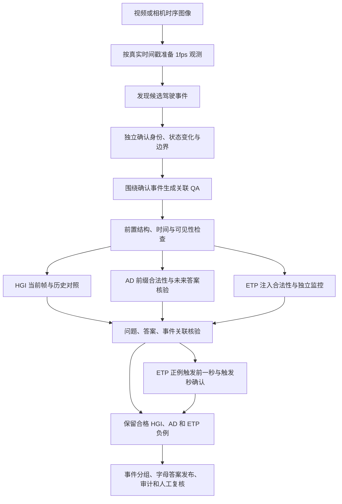

# StreamDriveBench：事件驱动的驾驶视频 QA 通用构建流程

更新时间：2026-10-15。本文依据三个项目当前构建入口、生成代码、发布与审计产物整理，重点描述数据构建，而非旧版独立问题生成或 VLM 评测流程。

本文是通用流程说明，仓库目前不包含三个工程的实现代码、数据、模型或凭据。下文命令需在已有对应工程和数据的计算环境运行；克隆本仓库不会自动安装这些依赖。

## 1. 研究单位与三类任务

研究目标：**以驾驶事件为共同单位，研究模型能否利用历史证据理解当前状态、形成对未来的预期，并随着新证据到来，在正确的时刻确认事件。**

| 类型 | 任务 | 构建时需要验证什么 |
|---|---|---|
| HGI | 利用历史理解当前目标、状态或行为来源 | 历史可支持唯一答案，当前单帧不能充分作答 |
| AD | 根据当前证据预测随后可观察的状态 | 查询时目标可识别、问题合法，独立未来证据支持答案；当前实现预测 +3 秒 |
| ETP | 在问题注入后持续观察，条件首次满足时回答 | 注入时条件尚未成立；此前保持 SILENT，触发时已有足够证据回答 |

区分两个层次：

- **event**：同一目标的一段持续驾驶行为，例如一次转弯。
- **transition**：事件内可观察的原子状态转换，例如开始转弯或完成转弯。

同一事件有三类题，不代表三类题都对应同一个转换。只有关联检查满足同一转换的要求，才进入严格三类配对子集。不能将“事件的三类覆盖数”直接当作严格三联数量。

## 2. 当前实现差异

| 配置项 | KITTI-360 | PIE 当前版本 | nuScenes 当前版本（v3 工程） |
|---|---|---|---|
| 项目 | `StreamDriveBench_KITTI-360` | `StreamDriveBench_PIE` | `StreamDriveBench_v3` |
| 输入 | 已切分的驾驶片段，默认左前相机 | PIE 原始视频，单前视图 | 官方 val 场景，`CAM_FRONT` |
| 数据时间基准 | 真实 PTS，1fps 观察 | 真实 PTS，1fps 观察 | 官方相机时间戳，1fps 观察 |
| 事件发现范围 | 30 秒事件归属区间，加前 10 秒、后 12 秒上下文 | 相邻不重叠的 30 秒窗口，不额外跨窗取发现图像 | 整段场景全部 1fps 帧，一次输入，不按时间窗切分 |
| 发现采样/配额 | 约每 2 秒取图；每归属区间最多 4 候选 | 本窗每秒取图；默认最多 1 候选/窗 | 全场景每秒取图；默认最多 1 候选/场景 |
| 出题顺序 | 先发现、定位、合并事件，再按任务分别出题 | 先确认本窗所有候选事件，再共享本窗图像生成三类题 | 先确认事件，再共享整段图像生成三类题 |
| 作者能否看查询时刻之后 | 作者仅接收经过因果目标定位的历史前缀；事件标签不直接提供 | 可以，属于离线、已知结果的出题 | 可以，属于离线、已知结果的出题 |
| 问题配额 | 每次作者最多 2 题，同事件可有多种题 | 每事件每类最多 1 题；不能出题需记录原因 | 每事件每类最多 1 题；不能出题需记录原因 |
| ETP 监控终点 | 注入后完整 30 秒 | 注入后完整 30 秒，允许跨发现窗口 | 场景最后一个可用采样帧，无固定监控秒数 |
| 作者模型默认值（项目配置） | `gpt-6-astra`，`low` | `gpt-6.1-sol`，`low` | `gpt-6.1-sol`，`low` |
| 当前调度 | 全部 18 clips，默认并发 2 | 三批新增 15/15/18 段；前两批并发 4，第三批 8 | 全 val / 固定随机 50 / 补足 50 个非空场景；默认并发 4 |

模型名称为工程中的实际配置标识，不是对某一 API 服务可用性或官方价格的保证。三个项目目前使用可配置的 Responses 兼容服务，运行前应检查所用服务的模型支持。

**不要把发现窗口、因果历史范围、AD 预测时长和 ETP 监控区间混为一个“时间窗”。** PIE 的发现窗口虽不重叠，ETP 核验仍会读取下一窗口中的未来监控帧；这些帧不能提前发送给在线作答模型。

## 3. 通用流水线



### 3.1 观察准备：先保证时间正确

1. 对每个整数秒，选该时刻及之前最近的源图像，不使用未来帧代替当前帧。
2. 保存基准秒、源 PTS/微秒时间戳、源图像标识与哈希，建立可追溯对应。
3. 图像年龄超过 0.5 秒或源观察缺失时，记录无效观察；不能将缺帧静默填充为可用证据。
4. 不将无关场景拼接成连续视频，不用假定帧率代替真实时间戳。
5. nuScenes 从 `sample_data` 经 `calibrated_sensor` / `sensor` 选出前视相机 samples 与 sweeps，只使用当前场景时间范围内的图像。生成模型不接收物体轨迹、速度、人工行为标签或场景文字描述。

### 3.2 事件发现与独立确认

发现只提出目标、行为、前后状态、粗略转换时刻和证据，不直接把候选当作真值。优先可见驾驶状态变化，如起步、停车、转向、穿行、车道变化与信号状态变化；避免隐藏意图、无依据的速度/距离推断。

确认调用检查目标连续性、状态变化、可见性与首次可观察边界。接受边界要求相邻的 `last_absent=t*-1` 和 `first_observable=t*` 证据。不清楚的边界直接拒绝，而不是强行指定时间。

KITTI-360 还执行基于图像的事件/转换合并，并允许独立 ETP 监测发现同一行为中的另一转换。PIE 与 nuScenes 当前精简流程先确认候选再批量出题，没有完整继承这套监测派生转换扩展。

### 3.3 事件驱动出题

**共同要求是先确认事件，再生成关联问题。** 但作者的信息隔离策略不同：

- KITTI-360：事件用于安排问题时刻。通过离线身份对应和因果目标描述，给作者提供当前可识别目标及历史前缀，不直接提供事件名、未来身份特征、事件边界或答案。查询时刻按事件边界和任务规划。
- PIE：确认本窗候选后，一次共享图像请求为确认事件分别提出 HGI、AD、ETP。作者只能使用确认的事件 ID；每类要么生成一题，要么说明遗漏原因。
- nuScenes：与 PIE 的确认后出题结构相同，但共享输入是整段场景的全部 1fps 帧；HGI/AD/ETP 的独立因果检查仍只看当时可见历史。

作者不直接提交最终答案，答案由后续独立核验确定。共享图像减少重复上传，但不意味着整个构建只调用一次 API。

PIE/nuScenes 作者看整窗/整段未来，因此数据必须标注离线出题来源。后续因果核验不能消除事件挑选、问题措辞或查询时刻选择中的未来偏差。

### 3.4 HGI：证明历史有用

分别检查完整可见历史与当前单帧。如果当前单帧已经充分支持答案，剔除该题。保留题需要目标可识别、答案明确、历史确实必要，并引用早于查询时刻的证据。

PIE 精简流程可优先做当前帧检查，能提前拒绝时跳过更贵的历史调用。nuScenes 整段版使用场景起点至查询时刻的全部 1fps 帧。一次模型消融是筛选机制，不是历史必要性的统计证明。

### 3.5 AD：前缀核验与未来标注分离

前缀核验只判断目标、问题和措辞是否合法，不因当前无法知道未来答案而拒绝正常预测题。独立未来核验使用 +3 秒观察确定答案；未来证据只用于离线标注，不能进入预测模型的当前输入。

如果实际状态没有合适选项、答案存在歧义、目标不可见，或 +3 秒超出允许范围，应拒绝。PIE 的查询和预测目标均在所属发现窗口内；nuScenes 则均在所属场景内。

### 3.6 ETP：把条件、时机与答案分开检查

1. 注入检查：目标当前可识别、条件尚未成立、只监测一个原子驾驶状态变化。
2. “当/如果发生才回答”不是对未来必然发生的断言；过去曾经发生，也不等于当前条件已经成立。
3. 独立监控不知道预期答案或候选触发点，逐秒判断首次满足条件的时刻。
4. 未触发前保持 SILENT；条件未观察到时保持 SILENT，不输出额外的“超时未发生”答案。
5. 遮挡、目标丢失、身份不确定不是负例；可见性不足应拒绝。
6. 关联核验后，对正例分别输入截止 `t*-1` 和截止 `t*` 的因果历史；前者必须沉默，后者必须已有足够证据作答。

两种 ETP 协议必须分别标记：

| 协议 | 监控区间 | 负例含义 | 尾部处理 |
|---|---|---|---|
| KITTI-360 / PIE | `[t, t+30]`，1fps 共 31 张观测、30 秒时间差 | 完整 30 秒内未观察到条件 | 无完整未来观察时拒绝，不截短为负例 |
| nuScenes 整段版 | `[t, N-1]`，直到最后采样帧 | 当前场景剩余观察期内未观察到条件 | 至少需要一张后续观测；标注实际终点和时长 |

nuScenes val 150 个场景首末关键帧跨度约 19.00–19.95 秒，原固定 30 秒协议无法生成 ETP。当前改为 `monitor_policy=scene_remainder`，记录 `monitor_end_second`、`monitor_duration_seconds` 与 `not_observed_before_scene_end`。它不是固定 30 秒负例的等价替代，跨数据集分析必须区分。

### 3.7 关联、去重与输出

独立关联核验不仅检查同一目标和行为，还检查答案与图像是否一致、选项是否覆盖实际观察。不能只因为事件相同就强行共享边界标签。重复输入/同义重复按各实现规则排除。

公开模型输入不能包含未来答案、事件边界、作者推理或人工标签。私有评估字段保留事件 ID、转换 ID、触发时刻、证据、监控范围和来源版本。

选项发布使用固定随机种子，按“题型 × 选项数量”尽量均衡正确答案位置，并同步所有答案与映射。普通题按实际选项数使用 A–D；五选项题允许 E。SILENT 是选项文本，其字母位置随题变化，不能把某个固定字母永久解释为沉默。合并旧发布时保留旧题及原字母映射，不重新打乱。

## 4. 建议保留的通用数据契约

下面是已有产物的逻辑归纳，不表示三个工程字段完全一致。跨项目汇总时，应显式转换字段并保留原文件，不应只按相同文件名直接混用。

| 层次 | 关键内容 |
|---|---|
| 场景/视频 | 数据集、原始序列/场景、split、相机、真实时间基准、采样率、源与帧哈希 |
| 事件 | event_id、transition_id、目标、行为、前后状态、确认边界和证据 |
| 问题 | query_id、family、查询时刻、题干、选项、目标描述、触发条件 |
| 输入策略 | 历史起点、当前截止时刻、ETP 实际监控终点、逐题独立评测策略 |
| 私有标签 | 字母答案、证据帧、触发点/最后未发生点、正负例语义、严格关联、版本来源 |
| 审计 | 各阶段输入/响应、接受与拒绝原因、遗漏原因、代码/配置哈希、缓存指纹与用量 |

典型产物：`events.json`、`event_groups.json`、`qa_candidates.json`、`queries_all.json`、`queries_strict_triplets.json`、`model_inputs.json`、`labels.json`、`option_mapping_audit.json`、`release_manifest.json`、`report.json`、`token_usage.json`。

ETP 运行器必须按时间顺序递送观察，不能在注入时把整个监控区间发给模型。评测时读取每题输入策略；不能把 nuScenes 场景终点协议、PIE 窗口内历史和 KITTI 历史设置统一替换为固定 30 秒。

## 5. 工程实现与当前 ACP 入口

以下均是**在对应工程中运行**的命令。默认 Python 环境与数据路径沿用部署环境；更换机器时需配置 `PROJECT_ROOT`、`SDB_PYTHON` 及相应数据路径。生成依赖 CPU 图像处理、存储和 API 网络访问，不等于在本地部署 VLM。

### 5.1 KITTI-360

核心：`src/kitti360_events/pipeline.py`、`scripts/finalize_event_qa.py`。数据默认位于 `data/KITTI-360/video_clips`，发布目录为 `releases/KITTI360_events_mcq_v1`。

```bash
cd /data/L202500514/code/StreamDriveBench_KITTI-360
bash scripts/run_event_qa_full_acp.sh
# 全量输出：outputs/event_grounded_v2/full18_injection_v3
# 后续字母答案发布
python scripts/prepare_letter_release.py
```

完整入口依次执行基础生成、独立 ETP 时机确认、结构审计与审阅页。`--max-events 0` 表示不对通过确认的事件再施加试跑选择上限，不等于发现无限事件。

原全量若已完成基础生成、仅最终核验因 429 中断，可用 `scripts/resume_event_qa_full_acp.sh` 恢复最终核验；该专用路径降低传输并发并做退避，不应为解决限流而绕过核验。

### 5.2 PIE

当前 `scripts/run_event_qa_window30_full_acp.sh` 已指向 `build_event_qa_window30_batch.py`，**必须指定批次**；早期资料中无参数直接全量运行的命令不再代表当前入口。

核心生成器仍为 `src/pie_events_window30_v2/` 和 `scripts/build_event_qa_window30_v2_full.py`；批次清单为 `configs/event_window30_batches.json`。

```bash
cd /data/L202500514/code/StreamDriveBench_PIE
bash scripts/run_event_qa_window30_batch1_acp.sh
# 第一批完成后再提交第二批
bash scripts/run_event_qa_window30_batch2_acp.sh
# 第二批完成后再提交第三批
bash scripts/run_event_qa_window30_batch3_acp.sh

# 等价显式入口示例
bash scripts/run_event_qa_window30_full_acp.sh --batch 1
```

在保留 5 段既有完整结果的基础上，新增 15、15、18 段。前两批默认并发 4，第三批 8。后续批次先验证之前批次完成和发布哈希，不会偷偷为未完成的前一批启动生成。

输出在 `outputs/event_grounded_pie_window30_v2/batch_01`、`batch_02`、`batch_03`。每批 `release_mcq` 为累计结果，`release_window30_mcq` 为该次构建计划中非复用部分；判断真实生成来源以 `source_releases.json` 为准。

复用旧样本不表示它们由当前流程重新生成或重新质量批准，尤其历史试跑已知问题应保留复核记录。

### 5.3 nuScenes（StreamDriveBench_v3）

当前使用 `src/nuscenes_event_qa_scene/` 与 `scripts/build_event_qa_scene.py`，不是旧的 `nuscenes_event_qa` 固定 30 秒实现。

```bash
cd /data/L202500514/code/StreamDriveBench_v3
# 单场景验证
bash scripts/run_event_qa_scene_pilot_acp.sh
# 全部官方 val
bash scripts/run_event_qa_scene_full_acp.sh
# 固定随机 50 场景
bash scripts/run_event_qa_scene_val50_acp.sh
# 在原随机批次基础上补至 50 个至少有 1 条 QA 的场景
bash scripts/run_event_qa_scene_extend50_acp.sh
```

随机 50 清单为 `configs/nuscenes_event_scene_val_random50.json`，seed=20261014，官方 val 中均匀无放回抽样。补充阶段 seed=20261015，冻结剩余随机顺序，排除已经尝试/完成的相关场景；每批并发数不超过剩余所需场景数，达到目标即停止。

“抽取 50 个视频”与“50 个视频成功生成 QA”是不同目标。补足后的样本条件是至少有一条自动接受 QA，因此最终集合不再是从整个 val 集均匀随机抽取的 50 场景。

当前结果：原随机 50 场景中 41 个非空、9 个零样本，105 条 QA；补充尝试 11 个场景，新增 9 个非空场景、18 条 QA。最终累计尝试 61 个，得到 50 个非空场景、123 条 QA（HGI 49、AD 46、ETP 28）。已有 `scene-0103` 试跑单独保留，不计入该 50 场景目标。

合并结果：

```text
outputs/event_grounded_nuscenes_scene_v2/
  val_positive50_seed20261015/
    selection_plan.json
    status.json
    completion_audit.json
    BUILD_REPORT.md
    runs/<scene>/
    release_mcq/queries_all.json
```

计数表示自动核验和发布完成，不表示所有场景三类齐全或已人工批准。

## 6. 缓存、断点与版本管理

- 请求缓存以模型、提示、结构化载荷、图像内容与响应协议等信息建立指纹。只有相同成功请求才能安全复用。
- 代码、配置、源数据与发布文件均应冻结/校验。改提示、事件配额、监控协议或模型后使用新输出目录，不能直接修改旧计划以绕过检查。
- 完成窗口/场景可跳过；场景发布需先检查哈希。目录中“存在文件”不等于生成完整。
- 已有 QA 的字母映射、来源和质量标记保留；合并需要检查 query_id 唯一性、公开/私有数量一致、媒体链接和源行逐条一致性。
- 并发以 API 在途请求和视频/场景工作线程共同限制；遇到传输失败保留检查点和错误记录。质量拒绝与 HTTP 错误分开统计。
- 密钥只通过私有环境配置或环境变量加载，禁止进入版本库、日志、数据集和示例命令。本文及仓库不提供凭据。
- 用量统计应区分本轮新增请求、共享缓存累计用量、失败/未确认请求；网络超时可能已经计费，本地成功响应 token 不是完整账单。

## 7. 质量检查与统计口径

每次构建至少检查：

1. 数据范围：官方 split、场景/序列、实际视频时长、图像时间戳、是否有缺帧或未来帧。
2. 覆盖：尝试场景数、完成数、零样本数、至少一题场景数；不能只报告 QA 总量。
3. 事件：发现候选、确认事件、同事件三类覆盖、严格同转换三联分别统计。
4. 问题：候选和保留数量、按类通过率、遗漏原因、拒绝原因；多标签拒绝不能直接相加当作独立问题数。
5. HGI：当前帧消融与历史必要性；AD：未来证据和选项覆盖；ETP：注入有效性、完整对应区间、相邻边界、可见性、触发前后确认。
6. 发布：合法字母、选项位置分布、SILENT 映射、重复问题、公开输入不含私有标签。
7. 人工复核：查看连续关键帧，重点核查停止与缓行、转弯与道路弯曲、转弯开始与完成、遮挡身份连续性。
8. 保留 `human_approved=false`，除非确实完成独立人工批准；模型间一致不等于人工准确率。

现有已验证例子：KITTI-360 的 18 片最终候选发布保留 1,041 条（HGI 382 / AD 334 / ETP 325），后续字母发布修复原始 HGI 首项偏差；nuScenes `scene-0103` 整段协议试跑有同一事件的三类各一题，ETP 在 8 秒注入、监控至 19 秒，9 秒 SILENT、10 秒首次可回答。以上只是具体产物/样例，不是三个数据集普适的质量保证。

## 8. 可推广边界

通用核心是**事件确认、三类任务的信息隔离、独立答案与时机核验、可追溯发布**，而不是固定 30 秒、固定事件数或某个 GPT 型号。

迁移到新数据集时，先决定：视频是否连续；相机与时间戳是否可靠；发现粒度；作者可见信息；预测与监控终点；负例能否被充分观测；原始序列级数据划分。先做小样例、再统计失败模式，最后扩展规模。

短场景采用监控至场景结束是协议变化，应明确标记并单独分析。整段作者仍存在未来信息选择偏差；1fps 的触发点只是首次可见采样秒；同模型多轮核验也不能替代独立人工真值。将这些限制写进产物，比通过静默截断、跨场景拼接或强行补题取得更高数量更重要。

## 9. 实现依据索引

下列路径相对于各项目根目录，供本地核对；本仓库只发布本文，不伪造指向未上传实现的链接。

- KITTI-360：`src/kitti360_events/pipeline.py`、`scripts/build_event_qa.py`、`scripts/finalize_event_qa.py`、`scripts/run_event_qa_full_acp.sh`、`scripts/prepare_letter_release.py`；文档 `docs/EVENT_GROUNDED_V2.md`、`docs/EVENT_GROUNDED_V3_FULL_BUILD.md`、`docs/VLM_EVALUATION_MCQ_V1.md`。
- PIE：`scripts/run_event_qa_window30_full_acp.sh`、`scripts/build_event_qa_window30_batch.py`、`scripts/build_event_qa_window30_v2_full.py`、`src/pie_events_window30_v2/protocol.py`、`src/pie_events_window30_v2/pipeline.py`、`configs/event_window30_batches.json`。
- nuScenes：`src/nuscenes_event_qa_scene/media.py`、`protocol.py`、`pipeline.py`、`release.py`、`scripts/build_event_qa_scene.py`、`scripts/extend_event_qa_to50.py`；文档 `docs/NUSCENES_EVENT_SCENE_V2.md`；最终产物 `val_positive50_seed20261015/completion_audit.json`。
